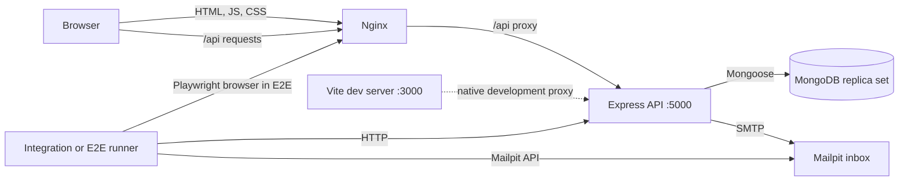

# PEERS architecture

PEERS is a browser-based peer evaluation application. The frontend is a React single-page app built with Vite and served as static files by Nginx in container builds. The backend is an Express API on Node.js; Mongoose connects it to MongoDB. The backend also sends application email through SMTP. In local and automated Compose environments that SMTP service is Mailpit, which captures messages in a disposable or local inbox.

## Runtime components

The diagram shows local Compose and isolated test relationships; native development uses Vite in place of the frontend container.

The browser uses the API base URL embedded in the frontend build. Native development uses Vite at port 3000 and its `/api` proxy to `localhost:5000`. The local Docker Compose frontend build sets the API base to `/api`; Nginx serves the app and forwards those same-origin requests to the `backend` service over Compose DNS. The standalone frontend image uses `nginx/default.conf`, which serves the app but has no API proxy; the Compose stack mounts `nginx/compose.conf` to add it. Without a build-time `VITE_API_BASE_URL`, a production build falls back to a deployed API address; runtime frontend environment variables do not change the built assets. Both Nginx configurations fall back to `index.html` for client routes and return 404 for missing CSS, JavaScript, source map, SVG, and font assets.

Vite loads the root `index.html`, uses the React plugin, and writes production assets to `build/`. Its configured browser targets control JavaScript transformations; they do not by themselves verify browser API or CSS compatibility. The [migration record](./archive/implementation-records/vite-migration.md) preserves the transition from Create React App and its historical checks.

The API exposes `/api/health`, which reports HTTP 200 only when the MongoDB connection is ready (503 otherwise); it does not check SMTP. The supplied local, integration, and E2E MongoDB containers run as single-node replica sets because evaluation submission uses transactions. MongoDB data is stored in the named `mongodb_data` volume for local Compose, and in temporary `tmpfs` storage for integration and E2E runs. Compose health checks gate service startup on MongoDB readiness, Mailpit readiness, API health, and, where used, frontend health.

## Source and image layout

- `src/frontend/` contains the React app, pages, components, contexts, and browser API services. `src/index.jsx` is the browser entry point and `src/frontend/App.jsx` assembles routes and app state.
- `src/backend/` contains the Express entry point (`index.js`), routes, controllers, middleware, Mongoose models, configuration, migrations, and backend tests.
- `Dockerfile` builds the Vite frontend with Node.js, then copies the compiled `build/` assets into Nginx. `src/backend/Dockerfile` installs production dependencies and runs the API with Node.js. `src/backend/Dockerfile.test` supplies the integration test runner; root `Dockerfile.e2e` supplies the Playwright browser runner.
- `docker-compose.yml` describes the local stack: MongoDB, Mailpit, backend, and frontend. It publishes ports only on localhost (27017, 1025, 8025, 5000, and 3000).

The frontend build and backend/test-runner images use Node.js 24; the frontend serving image is Nginx 1.28 Alpine. The E2E runner uses the Playwright image version selected from the locked package version. Compose also uses MongoDB 8 and Mailpit 1.27.4. Image definitions and version pins are authoritative in the Dockerfiles and Compose files.

Production `.dockerignore` files allowlist the inputs needed by each build; new runtime or frontend build inputs may require an allowlist update. The test Dockerfiles use their own ignore files to include their respective test suites. Build contexts are distinct from final images: the frontend serving image contains built assets and Nginx configuration, while the backend image contains production dependencies and included backend runtime files.

## Execution environments

| Environment | Shape and purpose | Data and network |
| --- | --- | --- |
| Native local development | Vite and Express run as host processes; developers provide MongoDB and optionally Mailpit separately. | Local settings are read from the root `.env`; services are managed separately. Vite proxies `/api` to the backend. |
| Local Docker Compose | Production-mode frontend and backend images plus MongoDB and Mailpit for everyday use. | MongoDB persists in `mongodb_data`; ports are bound to localhost. Email is captured locally. |
| Integration tests | `compose.test.yml` runs the backend and a dedicated Vitest runner with MongoDB and Mailpit. | Each invocation has a unique project/database, temporary DB storage, no published ports, and an internal Compose network. It exercises API/database/email integration without a browser. |
| E2E tests | `compose.e2e.yml` adds the built frontend and a Playwright runner to an isolated stack. | Temporary database storage, no published ports, and an internal network; the browser exercises the site and API together. |
| Staging | Delivery automation publishes separate backend and frontend images and deploys them to configured Render services. The frontend build points directly to the staging API. | MongoDB Atlas and the Mailtrap Email Testing sandbox are configured outside the images as backend runtime services; actual provider settings are managed separately. See the delivery guide for deployment and smoke details. |

Coverage Compose overlays (`compose.test.coverage.yml` and `compose.e2e.coverage.yml`) add runtime instrumentation to their respective test stacks; they are opt-in and do not change the local development stack.

## Further reading

- [Getting started](./getting-started.md) for the recommended local Compose setup.
- [Development](./development.md) for native development, configuration, and Compose operations.
- [Testing guide](./testing.md) for test layers and commands.
- [Continuous delivery](./staging-operations.md) for staging deployment and smoke checks.
